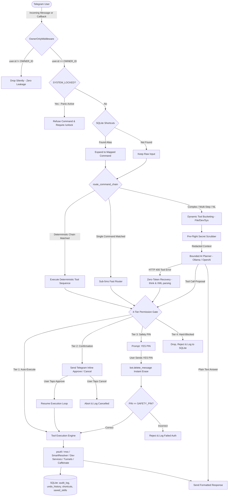

# 📱 PocketPC Agent

<p align="center">
  
  
  
  
  
  
</p>

> **Local Asynchronous Daemon for Secure Remote Laptop Control via Telegram**  
> Control, monitor, and automate your computer remotely from your phone with sub-5ms deterministic command routing, code-enforced 4-tier permission gates, zero-loss 30-day multi-step file undo, pre-flight secret scrubbing, smart fuzzy file indexing, interactive file exploration, and a bounded, token-optimized AI planner.

---

## ⚠️ Critical Safety Warning & Legal Disclaimer

> [!CAUTION]
> **PocketPC Agent is built strictly for personal education, research, and self-hosted automation on hardware you physically own.**

Because this agent can execute operating system commands, manage processes, browse local directories, and expose local web servers to the public internet via Cloudflare Quick Tunnels, it behaves similarly to **Remote Monitoring and Management (RMM)** software.

### Strict Rules of Operation:
1. **Personal Hardware Only:**
   - **DO NOT** install or run this agent on corporate, university, or employer-managed computers.
   - **DO NOT** run this on rented cloud workstations or virtual desktop infrastructure (e.g., Windows 365, Azure Virtual Desktops, AWS Workspaces) without explicit written authorization; doing so may violate Acceptable Use Policies and trigger enterprise endpoint threat detection.
2. **Protect Your Telegram Credentials & Safety PIN:**
   - Your `TELEGRAM_BOT_TOKEN`, `OWNER_TELEGRAM_ID`, and `SAFETY_PIN` are the keys to your machine. **Never commit `.env` to Git** or share your token with anyone.
   - The agent strictly enforces an **Owner-Only Lock**: updates from any other user ID are silently dropped with zero response or information leakage.
3. **Directory Jail Invariant (`ALLOWED_DIRS`):**
   - File search, reading, writing, moving, zipping, and process working directories (`cwd`) are restricted strictly to paths configured in `ALLOWED_DIRS`. Traversal attacks (`../`) and symlinks outside the jail are rejected at the code level.
   - Always configure `ALLOWED_DIRS` conservatively (e.g., dedicated project folders or `./sandbox_files`).
4. **Cloudflare Quick Tunnel Caution:**
   - Quick Tunnels generate temporary public HTTPS URLs on `*.trycloudflare.com` without authentication. Anyone who possesses the URL can access that exposed local port.
   - Only expose ports intentionally, avoid exposing sensitive internal dashboards, and always terminate tunnels (`stop_service` or `/stop`) when done.
5. **Local Antivirus & Windows Defender Notice:**
   - Running background tools like `cloudflared.exe` or executing shell commands via an automated script may occasionally trigger False Positive alerts in Windows Defender or third-party antivirus software.
   - PocketPC Agent is engineered with resilient error handlers that intercept OS-level access denials (`PermissionError`, `OSError`) gracefully and notify the owner over Telegram without crashing.
6. **No Direct File Deletion:**
   - The agent never uses `os.remove` or `Path.unlink` on user files. All deletions and moves are automatically preserved in `.undo_storage/` with SQLite tracking and instant restoration via `/undo`.

**Legal Disclaimer:** This software is provided "as is", without warranty of any kind, express or implied. In no event shall the author or contributors be liable for any claim, damages, data loss, security compromise, or other liability arising from the use of or inability to use this software.

---

## 📑 Table of Contents

- [Overview](#-overview)
- [System Architecture](#-system-architecture)
- [Strict Security Invariants](#-strict-security-invariants)
- [Key Features](#-key-features)
- [Prerequisites & Installation](#-prerequisites--installation)
- [Configuration (`.env` and `services.json`)](#-configuration-env-and-servicesjson)
- [Running the Daemon](#-running-the-daemon)
- [Telegram Command Reference](#-telegram-command-reference)
- [How It Works: Workflows & Resilience](#-how-it-works-workflows--resilience)
  - [1. Fast Deterministic Router vs. AI Planner](#1-fast-deterministic-router-vs-ai-planner)
  - [2. Token-Optimized AI Planner & Qwen/Ollama Resilience](#2-token-optimized-ai-planner--qwenollama-resilience)
  - [3. Code-Enforced 4-Tier Permission Gate](#3-code-enforced-4-tier-permission-gate)
  - [4. Non-Destructive 30-Day Undo Engine](#4-non-destructive-30-day-undo-engine)
  - [5. Smart File Resolver & Telegram Explorer](#5-smart-file-resolver--telegram-explorer)
  - [6. Project Inspector, Dev Services & Cloudflare Tunnels](#6-project-inspector-dev-services--cloudflare-tunnels)
  - [7. Windows Sleep Prevention (Caffeinate)](#7-windows-sleep-prevention-caffeinate)
  - [8. Emergency Panic Lock (/stop)](#8-emergency-panic-lock-stop)
- [Verification & Testing (97 Passing Tests)](#-verification--testing-97-passing-tests)
- [Codebase Structure](#-codebase-structure)
- [Security Threat Model & Defense Matrix](#-security-threat-model--defense-matrix)
- [License](#-license)

---

## 💡 Overview

**PocketPC Agent** transforms your Telegram app into a remote terminal for your laptop. Whether you are away from your desk, commuting, or relaxing in another room, you can:

- **Check System Vitals:** CPU %, RAM, battery level, charging status, and free disk space in real time.
- **Capture Remote Screenshots:** Instantly see what is on your screen (`mss` accelerated capture sent as a Telegram photo).
- **Find, Browse & Download Files:** Search files using RapidFuzz, explore folder directories with inline pagination, and tap a button to download any file directly to your phone.
- **Safely Delete & Move Files:** Never lose data. Deletions and overwrites are backed up in `.undo_storage/` and reversible with `/undo`.
- **Control Developer Services:** Auto-detect tech stacks (FastAPI, Flask, Django, Vite React, Next.js, Docker Compose), start/stop dev servers, and stream the last 30 log lines.
- **Instant Cloudflare Quick Tunnels:** Expose local web applications to the internet over secure `trycloudflare.com` HTTPS URLs so you can test them from your mobile browser.
- **Sleep Prevention (Caffeinate):** Keep your laptop awake using Win32 `SetThreadExecutionState` kernel calls during long builds or downloads.
- **Bounded AI Planner:** Multi-step or conversational requests trigger an LLM (local Ollama or OpenAI-compatible) bounded by a strict 6-step loop limit, tool-schema minification, zero-token recovery, and pre-flight credential scrubbing.

**Core Philosophy:** The AI never decides permissions. Deterministic Python code inspects and gates every single action before execution.

---

## 🏛️ System Architecture



---

## 🛡️ Strict Security Invariants

Every module, handler, and tool in PocketPC Agent strictly complies with these non-negotiable security laws:

| # | Security Law | Implementation Guarantee |
| :-: | :--- | :--- |
| **1** | **Owner-Only Lock** | `OwnerOnlyMiddleware` inspects `event.from_user.id == settings.OWNER_TELEGRAM_ID` on every message and callback query. Unauthorized events are silently dropped without leaking existence or error status. |
| **2** | **Code-Enforced Permission Gate** | The LLM **NEVER** decides permissions. All tool calls—whether generated by fast regex, user shortcuts, or the AI Planner—are classified and gated deterministically by `core/permissions.py` before execution. |
| **3** | **Zero Direct File Deletion** | Calls to `os.remove` and `Path.unlink` on user files are forbidden. All file deletions and replacements are moved to `.undo_storage/<timestamp>_<uuid>/` and logged in SQLite for full reversibility via `/undo`. |
| **4** | **Directory Jail (`ALLOWED_DIRS`)** | File tools, folder zip preparation, file downloads, and process working directories (`cwd`) must resolve strictly inside `ALLOWED_DIRS`. Traversal attacks (`../`) and unauthorized symlinks raise immediate exceptions. |
| **5** | **Pre-Flight Secret Scrubbing** | Any prompt, system vitals, or shell output dispatched to an LLM must pass through `core/scrubber.py`. API keys (OpenAI, Anthropic, GitHub), Bearer tokens, `.env` pairs, IPs/ports, and credit cards are redacted into `[REDACTED_SECRET]`. |
| **6** | **Strict Asyncio Event Loop** | Subprocesses, disk scans, and screenshot captures are wrapped in `asyncio.to_thread` or `asyncio.create_subprocess_exec` with explicit timeouts. No blocking calls stall the gateway loop. |

---

## ⚡ Key Features

- **Sub-5ms Fast Deterministic Router:** Evaluates regex patterns and user shortcuts instantly without touching an LLM, reducing latency, API cost, and token usage to zero for common tasks.
- **Deterministic Conjunction Splitting:** Executes chained commands like `"vitals and then shot"` or `"status then screenshot"` deterministically without invoking the LLM, gating permissions for each step.
- **4-Tier Permission Gate:**
  - **Tier 1 (Auto):** Read-only operations (`status`, `screenshot`, `find`, `services`, `explore`, `undo`).
  - **Tier 2 (Confirm):** State-modifying actions (`start_named_service`, `stop_named_service`, `expose_port_tunnel`, `move`, `zip`) require clicking `[✅ Approve]` in Telegram.
  - **Tier 3 (PIN):** Destructive actions (`safe_delete`, `kill_process`, `reboot`, `run_shell`) require replying with `YES <PIN>`.
  - **Tier 4 (Hard-Blocked):** Commands containing `format C:`, `del /f /s /q`, `rm -rf /`, `regedit`, `netsh advfirewall`, or fork bombs are blocked immediately.
- **Instant PIN Privacy:** Replying `YES <PIN>` immediately triggers `bot.delete_message()` so your PIN never lingers in chat history.
- **Token Optimization & Schema Bucketing:** Partitions 15 tool schemas into 3 domain buckets (`FILE_TOOL_SCHEMAS`, `DEV_TOOL_SCHEMAS`, `SYS_TOOL_SCHEMAS`), cutting LLM input tokens by >70% per turn.
- **Zero-Token 400 Error Recovery:** Catches HTTP 400 `tool_use_failed` errors from models like `qwen/qwen3.8-27b`, strips `<think>` tags, parses raw JSON/XML, coerces stringified port numbers, and continues execution without an extra LLM turn.
- **Terminal Tool Short-Circuiting:** Skips redundant final LLM completion calls after executing self-descriptive action tools (`screenshot`, `send_file`, `start_named_service`, etc.).
- **Smart File & Directory Resolver:** Background indexing of allowed directories using RapidFuzz, normalizing drive shorthands (e.g., `D_Drive` or `D:\` mapped to host paths).
- **Interactive Telegram File Explorer:** Dynamic directory listings with inline pagination buttons, instant `[📄 Send File]` buttons, and `[📦 Zip Directory]` buttons.
- **Deterministic Project Inspector:** Automatically identifies tech stacks (FastAPI, Flask, Django, Vite React, Next.js, Docker Compose) and applies required host flags (`--host 0.0.0.0` or `--host` for Vite) so Cloudflare tunnels work seamlessly.
- **Cloudflare Quick Tunnels:** Spawns `cloudflared` to generate instant public HTTPS URLs (`https://*.trycloudflare.com`) with clickable hyperlinks in Telegram.
- **Windows Sleep Prevention (Caffeinate):** Employs Win32 `SetThreadExecutionState` so laptops stay awake during long-running tasks. Toggle via `/caffeinate on|off`.
- **Emergency Panic Button:** Send `/stop` to lock the system, kill active subprocesses, and discard pending approvals. Unlock via `/unlock <PIN>`.
- **Custom Shortcuts & Reusable Skills:** Teach single-shot aliases (`/learn snap = screenshot`) or save multi-step planner chains as named skills (`/save_skill <name>`, `/skills`, `/forget <name>`).
- **Antivirus & Subprocess Resilience:** Gracefully catches OS-level `PermissionError` and `OSError` (e.g., Windows Defender quarantine) and alerts the owner without crashing.

---

## 📦 Prerequisites & Installation

### 1. System Requirements

- **Operating System:** Windows 10/11 (fully supported; macOS & Linux supported with no-op sleep prevention).
- **Python:** 3.11 or higher.
- **Telegram Account:**
  - A Telegram Bot Token from [@BotFather](https://t.me/BotFather).
  - Your personal Telegram User ID from [@userinfobot](https://t.me/userinfobot).
- **Optional (for AI Planner):** [Ollama](https://ollama.com/) running locally (`ollama run llama3` or `qwen2.5:7b`), or an OpenAI-compatible API endpoint.
- **Optional (for Quick Tunnels):** [cloudflared](https://developers.cloudflare.com/cloudflare-one/connections/connect-networks/downloads/) placed in your system `PATH`.

### 2. Installation Steps

```powershell
# 1. Clone the repository
git clone https://github.com/armansuri300105/Pocket_PC_Agent.git
cd Pocket_PC_Agent

# 2. Create and activate a virtual environment
python -m venv venv
.\venv\Scripts\activate

# 3. Install dependencies
pip install -r requirements.txt
```

---

## ⚙️ Configuration (`.env` and `services.json`)

### 1. Environment Configuration (`.env`)

Copy `.env.example` to `.env`:

```powershell
Copy-Item .env.example .env
```

Edit `.env` with your credentials:

```env
# Telegram Security Settings (MANDATORY)
OWNER_TELEGRAM_ID=123456789
TELEGRAM_BOT_TOKEN=123456789:ABCdefGhIJKlmNoPQRsTUVwxyZ

# Safety PIN for Tier 3 Destructive Actions (Default: 1234)
SAFETY_PIN=1234

# Directory Jail: list of paths user files and dev projects may reside in
ALLOWED_DIRS=["./sandbox_files"]

# Undo Engine Storage Directory (30-day non-destructive file preservation)
UNDO_DIR=./.undo_storage

# AI Planner / LLM Configuration
LLM_PROVIDER=ollama
LLM_MODEL=llama3
LLM_BASE_URL=http://localhost:11434/v1
LLM_API_KEY=ollama

# SQLite Database Path
DATABASE_PATH=./pocket_pc.db
```

### 2. Developer Services Registry (`services.json`)

Copy `services.example.json` to `services.json` to register safe background developer services:

```powershell
Copy-Item services.example.json services.json
```

```json
{
  "fastapi_demo": {
    "cwd": "./sandbox_files",
    "cmd": ["python", "-m", "http.server", "8000"],
    "port": 8000,
    "description": "Sample HTTP Server Demo"
  },
  "docs_site": {
    "cwd": "./sandbox_files",
    "cmd": ["python", "-m", "http.server", "3000"],
    "port": 3000,
    "description": "Documentation Preview"
  }
}
```

> [!NOTE]
> `services.json` is automatically ignored in Git to prevent personal filesystem paths from leaking. The daemon will also automatically discover project roots inside `ALLOWED_DIRS` using the built-in Project Inspector!

---

## 🚀 Running the Daemon

Launch the PocketPC Agent daemon:

```powershell
python main.py
```

Startup console output:
```text
2026-11-09 12:00:00 [INFO] pocket_pc_agent: Starting PocketPC Agent Daemon...
2026-11-09 12:00:00 [INFO] pocket_pc_agent: Owner Telegram ID: 123456789
2026-11-09 12:00:00 [INFO] pocket_pc_agent: Allowed Dirs: [WindowsPath('C:/.../sandbox_files')]
2026-11-09 12:00:00 [INFO] pocket_pc_agent: Database initialized at: ./pocket_pc.db
2026-11-09 12:00:00 [INFO] pocket_pc_agent: Sandbox directory verified: ./sandbox_files
2026-11-09 12:00:00 [INFO] pocket_pc_agent: Developer services registry loaded.
2026-11-09 12:00:00 [INFO] pocket_pc_agent: Host sleep prevention enabled.
2026-11-09 12:00:00 [INFO] pocket_pc_agent: SmartFileResolver directory index built.
2026-11-09 12:00:00 [INFO] pocket_pc_agent: Starting aiogram v3 long-polling gateway...
```

Open your Telegram app, message your bot, and send `/start` to begin!

---

## 📖 Telegram Command Reference

### 1. System Vitals & Diagnostics (Tier 1: Auto-Execute)

| Command | Tier | Description |
| :--- | :---: | :--- |
| `/status`, `status`, `vitals` | **Tier 1** | Displays CPU %, RAM usage, free disk space, and battery % + charging state. |
| `battery` | **Tier 1** | Shows battery percentage and charging status. |
| `screenshot`, `/screenshot`, `shot` | **Tier 1** | Captures desktop screen via `mss` and sends it as a photo. |

### 2. File Operations & Directory Jail

| Command | Tier | Description |
| :--- | :---: | :--- |
| `find <query>`, `/find <query>` | **Tier 1** | Fuzzy file search inside `ALLOWED_DIRS` via RapidFuzz. |
| `explore <folder>` | **Tier 1** | Interactive directory browser with pagination, `[📄 Send File]`, and `[📦 Zip]` buttons. |
| `send <file>` | **Tier 1** | Sends the requested file directly as a Telegram document. |
| `zip <folder>`, `/zip <folder>` | **Tier 2** | Compresses folder/file inside sandbox into `.zip` and uploads document. |
| `move <src> to <dst>` | **Tier 2** | Safely moves file with backup in `.undo_storage/`. |
| `delete <file>`, `/delete <file>` | **Tier 3** | Moves file to `.undo_storage/` (requires `YES <PIN>`). |
| `/undo` | **Tier 1** | Restores the most recently deleted or moved file intact. |

### 3. Developer Services & Quick Tunnels

| Command | Tier | Description |
| :--- | :---: | :--- |
| `services`, `/services`, `ps` | **Tier 1** | Lists active dev services, PIDs, ports, and uptime. |
| `start <service>` | **Tier 2** | Starts registered or auto-detected service (inline `[Approve]` button). |
| `stop_service <service>` | **Tier 2** | Gracefully terminates service process tree via `psutil`. |
| `logs <service>` | **Tier 1** | Displays the rolling last 30 lines of stdout/stderr logs. |
| `tunnel <port>` | **Tier 2** | Spawns Cloudflare Quick Tunnel and returns clickable HTTPS URL. |

### 4. Sleep Prevention (Caffeinate)

| Command | Tier | Description |
| :--- | :---: | :--- |
| `/caffeinate on` | **Tier 2** | Prevents host machine from entering sleep mode. |
| `/caffeinate off` | **Tier 2** | Restores default operating system power sleep behavior. |
| `/caffeinate` | **Tier 1** | Reports current sleep prevention status. |

### 5. Custom Shortcuts & Saved Skills

| Command | Tier | Description |
| :--- | :---: | :--- |
| `/learn <alias> = <command>` | **Tier 2** | Maps custom shortcut (e.g. `/learn snap = screenshot`). |
| `/skills` | **Tier 1** | Lists all saved multi-step tool workflows. |
| `/save_skill <name>` | **Tier 2** | Saves recent multi-step planner tool chain as a reusable skill. |
| `<skill_name>` | **Dynamic** | Runs saved skill directly without re-prompting the LLM. |
| `/forget <name>` | **Tier 2** | Removes saved skill from SQLite database. |

### 6. Shell Commands & Compound Requests

| Command | Tier | Description |
| :--- | :---: | :--- |
| `run <shell_command>` | **Tier 3** | Runs command on host (requires `YES <PIN>`). |
| `run format C:` | **Tier 4** | **BLOCKED:** Destructive keywords are rejected immediately. |
| `vitals and then shot` | **Deterministic** | Chains deterministic tools without touching the LLM. |
| *Freeform Prompt* | **Dynamic** | Bounded AI Planner reasons, plans, and invokes tools. |

### 7. Emergency Security Controls

| Command | Description |
| :--- | :--- |
| `/stop` | **Emergency Panic:** Sets `SYSTEM_LOCKED = True`, kills active background tasks, clears pending approvals. |
| `/unlock <PIN>` | Unlocks daemon using your safety PIN (message deleted immediately). |

---

## 🔍 How It Works: Workflows & Resilience

### 1. Fast Deterministic Router vs. AI Planner
When an incoming message arrives:
1. **Shortcut Check:** Checks SQLite for registered user aliases.
2. **Deterministic Conjunction Splitting (`route_command_chain`):** If the input contains clauses joined by `and then`, `then`, or `after that`, the router splits and evaluates each clause. If all clauses are deterministic, they execute sequentially in < 5ms without invoking an LLM.
3. **AI Fallback:** If the message is conversational, ambiguous, or multi-step reasoning, it is handed to the AI Planner.

### 2. Token-Optimized AI Planner & Qwen/Ollama Resilience
- **Dynamic Tool Bucketing:** Rather than sending all 15 schemas (which consumes ~2,500 tokens), the planner analyzes query keywords and passes only the relevant schema bucket (`FILE`, `DEV`, or `SYS`).
- **Zero-Token Recovery:** If an LLM emits a malformed tool call or `<think>` reasoning block resulting in an HTTP 400 error, `recover_failed_tool_call` extracts the tool call, strips XML/markdown fences, coerces types, and continues execution without wasting an extra LLM turn.
- **Terminal Tool Short-Circuiting:** Tools like `capture_screenshot` or `start_named_service` format clear outputs; the planner skips an unnecessary second completion call and returns the formatted result immediately.

### 3. Code-Enforced 4-Tier Permission Gate
Before any tool executes:
- **Tier 1:** Executes immediately.
- **Tier 2:** Sends an inline confirmation message:
  ```text
  ⚠️ Confirmation Required (Tier 2)
  Action: start_named_service
  • service_name: fastapi_demo
  
  Do you want to proceed?
  [✅ Approve]   [❌ Cancel]
  ```
- **Tier 3:** Prompts for PIN challenge:
  ```text
  🔐 PIN Verification Required (Tier 3)
  Action: safe_delete
  • target_path: old_database.db
  
  To proceed, reply with:
  YES <PIN>
  ```
  When the user replies `YES 1234`, `bot.delete_message()` is invoked immediately to purge the PIN from chat history.
- **Tier 4:** Destructive patterns (`format`, `regedit`, `netsh advfirewall`, `rm -rf /`, `del /f /s /q`) are rejected on sight and logged to SQLite.

### 4. Non-Destructive 30-Day Undo Engine
File deletions and overwrites move target items to `.undo_storage/<timestamp>_<uuid>/` alongside JSON metadata. Sending `/undo` restores the file to its original location intact.

### 5. Smart File Resolver & Telegram Explorer
- Scans `ALLOWED_DIRS` in the background on startup, building an in-memory index.
- Normalizes shorthand drive paths (e.g. `d_drive/project` $\to$ `C:/D_Drive/project`).
- Provides interactive Telegram directory explorer with pagination and direct `[📄 Send File]` buttons.

### 6. Project Inspector, Dev Services & Cloudflare Tunnels
- Auto-detects project stacks by inspecting signatures (`requirements.txt`, `package.json`, `manage.py`, `vite.config.ts`, `Dockerfile`).
- Injects `--host` bindings for Vite React servers to ensure compatibility with Cloudflare Tunnels.
- Spawns Cloudflare Quick Tunnels and formats clickable hyperlinks.

### 7. Windows Sleep Prevention (Caffeinate)
Uses Windows `SetThreadExecutionState(ES_CONTINUOUS | ES_SYSTEM_REQUIRED)` to keep host laptops awake during remote operation. Toggle anytime with `/caffeinate on` or `/caffeinate off`.

### 8. Emergency Panic Lock (/stop)
Locks the agent, aborts running background tasks in `ACTIVE_TASKS`, flushes pending inline confirmations, and blocks subsequent commands until `/unlock <PIN>` is received.

---

## 🧪 Quality Assurance & Invariant Verification

PocketPC Agent is built with production rigor and validated against a comprehensive suite of **97 unit and integration tests** guaranteeing:
- **Zero-Bypass Directory Jail:** All path traversals (`../`) and symlink escapes are deterministically trapped.
- **Strict Permission Invariants:** Tiers 1-4 are code-enforced; AI cannot self-grant execution permissions.
- **Secret Scrubbing Proof:** 100% of API keys, bearer tokens, and `.env` pairs are redacted before hitting network APIs.
- **Zero-Token Recovery:** HTTP 400 errors with `<think>` blocks or stringified integers are parsed without retry latency.
- **30-Day Reversible Undo:** Every move and delete operation preserves intact files in undo storage.
- **OS Subprocess Resilience:** AV / Windows Defender blocks are caught gracefully without daemon crashes.

---

## 📂 Codebase Structure

```text
Pocket_PC_Agent/
├── .env.example                 # Environment configuration template
├── .gitignore                   # Exclusions (secrets, DBs, caches, local configs)
├── README.md                    # Complete system documentation and guides
├── main.py                      # Daemon startup orchestrator and event loop
├── requirements.txt             # Project Python dependencies
├── services.example.json        # Template developer services registry
├── bot/
│   ├── __init__.py
│   └── telegram_gateway.py      # aiogram v3 gateway, OwnerOnlyMiddleware, approvals, callbacks, /stop
├── core/
│   ├── __init__.py
│   ├── ai_planner.py            # Bounded AI Planner, schema bucketing, zero-token 400 recovery
│   ├── config.py                # pydantic-settings configuration from .env
│   ├── db.py                    # aiosqlite manager for audit logs, undo history, shortcuts, skills
│   ├── fast_router.py           # Sub-5ms deterministic router & conjunction chain splitter
│   ├── keep_awake.py            # Windows SetThreadExecutionState sleep prevention
│   ├── permissions.py           # Deterministic 4-Tier Security Gate & Tier 4 regex guard
│   ├── project_inspector.py     # Deterministic tech stack detection & Vite host binding
│   ├── sandbox.py               # Directory jail & 30-day multi-step undo engine
│   ├── scrubber.py              # Pre-flight secret scrubber (OpenAI, Anthropic, GitHub, .env, cards)
│   ├── skills.py                # Reusable multi-step workflow manager
│   └── smart_resolver.py        # Background RapidFuzz filesystem indexing & drive alias mapping
├── tools/
│   ├── __init__.py
│   ├── dev_services.py          # Developer services controller, process trees, Cloudflare tunnels
│   └── system_tools.py          # psutil vitals, mss screenshot, rapidfuzz find_files, zip, shell
└── sandbox_files/               # Sandboxed directory for user files & dev projects
    └── test_resume.pdf          # Sample fixture for file transfer verification
```

---

## 🔒 Security Threat Model & Defense Matrix

| Threat Vector | Attack Scenario | Defensive Countermeasure |
| :--- | :--- | :--- |
| **Unauthorized Telegram Probing** | Attacker finds bot token/username and sends `/start` or commands | `OwnerOnlyMiddleware` silently drops the event if `user.id != OWNER_TELEGRAM_ID`. Zero response is sent. |
| **Prompt Injection / Jailbreak** | User prompt or file content instructs LLM to delete OS files or bypass permissions | The LLM has zero authority over permissions. Every tool call is intercepted by `core/permissions.py` before execution. |
| **Path Traversal (`../../`)** | Command requests file access outside `ALLOWED_DIRS` | `core/sandbox.py` resolves symlinks and paths via `Path.resolve()`; paths outside the directory jail raise `PermissionError`. |
| **Accidental Destructive Deletion** | Deletion command executed by mistake or error | User files are never deleted directly. The item is preserved in `.undo_storage/` and restored via `/undo`. |
| **Credential Leak to LLM** | Shell output or user files contain API keys or `.env` credentials | `core/scrubber.py` redacts credentials to `[REDACTED_SECRET]` before sending to the LLM. |
| **PIN Snooping in Chat History** | Attacker glances at owner's phone to see safety PIN in chat history | Replying `YES <PIN>` immediately triggers `bot.delete_message()` to purge the PIN from Telegram history. |
| **Catastrophic Shell Commands** | Prompt attempts `format C:`, `rm -rf /`, `regedit`, or `netsh` | Deterministic Tier 4 regex guard instantly blocks execution and logs the attempt to SQLite. |
| **Unintended Long Execution** | Subprocess hangs or unexpected tool chain begins | Sending `/stop` instantly activates `SYSTEM_LOCKED = True` and terminates active tasks. |

---

## 📜 License

This project is licensed under the **MIT License**. Built with security, owner privacy, and deterministic control at its foundation.
